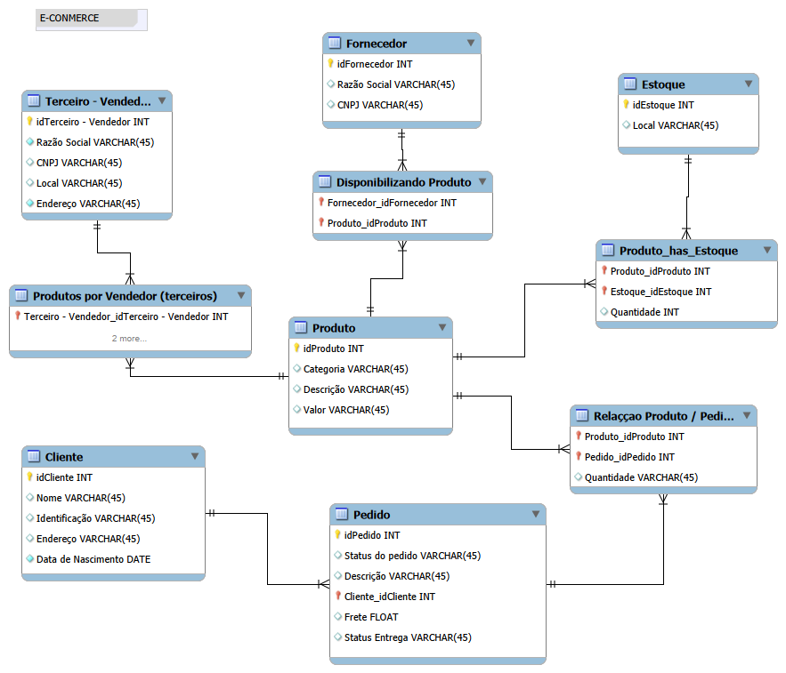

# 🛒 Projeto Lógico de Banco de Dados para E-Commerce

<p align="center">
  
  
  
  
</p>

---

## 📌 Descrição

Projeto desenvolvido como parte do desafio de modelagem lógica de banco de dados utilizando MySQL.

O sistema simula um cenário de **E-Commerce**, contemplando clientes, produtos, pedidos, pagamentos, fornecedores, vendedores, estoque e entregas.

O projeto envolve a modelagem lógica do banco de dados, sua implementação em MySQL, inserção de dados para testes e desenvolvimento de consultas SQL para análise das informações.

---

## 📸 Visão Geral do Modelo

Abaixo está o Diagrama Entidade-Relacionamento (DER) utilizado como base para implementação do banco de dados.

<p align="center">
  
</p>

O modelo representa as principais entidades e relacionamentos de um ambiente de comércio eletrônico.

---

## 🎯 Objetivos do Projeto

- Construir um modelo lógico relacional;
- Implementar o banco de dados em MySQL;
- Aplicar relacionamentos entre entidades;
- Implementar refinamentos de negócio;
- Desenvolver consultas SQL;
- Validar a integridade dos dados.

---

## 🏗️ Estrutura do Banco de Dados

O projeto foi modelado utilizando as seguintes entidades principais:

### Clientes

- clients
- clientPF
- clientPJ

### Produtos

- product

### Pedidos

- orders
- payment
- delivery

### Comercial

- supplier
- seller

### Estoque

- productStorage

As entidades foram modeladas para representar um cenário completo de comércio eletrônico, contemplando clientes pessoa física e jurídica, gestão de produtos, pedidos, estoque, fornecedores, vendedores e entregas.

---

## 🧩 Refinamentos Implementados

### ✅ Especialização de Clientes (PF e PJ)

Os clientes foram separados em:

- Pessoa Física (PF)
- Pessoa Jurídica (PJ)

permitindo maior organização e consistência dos dados.

---

### ✅ Múltiplas Formas de Pagamento

O modelo permite que um cliente possua mais de uma forma de pagamento cadastrada.

Exemplos:

- Cartão de Crédito
- Cartão de Débito
- PIX
- Boleto

---

### ✅ Controle de Entregas

Foi implementado um mecanismo de acompanhamento de entregas contendo:

- Código de rastreio
- Status da entrega

permitindo monitorar o andamento dos pedidos.

---

## 🗂️ Modelo Lógico

O modelo lógico utilizado como base para implementação encontra-se disponível nos arquivos:

- DER.pdf
- ecommerce-der.png
- ECOMMERCE.mwb

O diagrama apresenta as entidades, atributos e relacionamentos do banco de dados.

---

## 🛠️ Tecnologias Utilizadas

- MySQL
- SQL
- MySQL Workbench
- Git
- GitHub

---

## 📂 Estrutura do Projeto

```text
projeto-logico-ecommerce
│
├── README.md
├── ecommerce.sql
├── ECOMMERCE.mwb
├── DER.pdf
└── ecommerce-der.png
```

### 📄 ecommerce.sql

Arquivo principal contendo:

- Criação do banco de dados;
- Criação das tabelas;
- Definição dos relacionamentos;
- Inserção dos dados para testes;
- Consultas SQL.

### 📄 ECOMMERCE.mwb

Arquivo de modelagem desenvolvido no MySQL Workbench.

### 📄 DER.pdf

Versão em PDF do Diagrama Entidade-Relacionamento.

### 🖼️ ecommerce-der.png

Imagem do DER para visualização rápida da estrutura do banco.

---

## 🔍 Consultas Desenvolvidas

O projeto contempla consultas utilizando:

- SELECT
- WHERE
- ORDER BY
- HAVING
- JOIN
- CASE
- COUNT()

---

## 📊 Consultas Implementadas

Entre as consultas desenvolvidas estão:

- Quantidade de pedidos por cliente;
- Clientes com mais de um pedido;
- Relação entre produtos e fornecedores;
- Produtos disponíveis em estoque;
- Produtos, fornecedores e estoque;
- Acompanhamento das entregas;
- Classificação de frete;
- Frete com taxa adicional;
- Identificação de clientes PF e PJ;
- Verificação de fornecedores que também atuam como vendedores.

---

## ✅ Resultados

O banco de dados foi implementado com sucesso em MySQL.

Foram realizados:

✅ Modelagem lógica;

✅ Implementação física;

✅ Inserção de dados para testes;

✅ Desenvolvimento de consultas SQL;

✅ Validação dos relacionamentos;

✅ Execução das consultas sem erros.

---

## 🚀 Competências Demonstradas

- Modelagem Lógica de Dados
- Banco de Dados Relacional
- SQL
- MySQL
- MySQL Workbench
- Chaves Primárias e Estrangeiras
- Relacionamentos entre Entidades
- Normalização
- Consultas SQL
- Regras de Negócio
- Documentação Técnica

---

## 👨‍💻 Autor

**Rodrigo Oliveira**

🔗 LinkedIn:  
https://www.linkedin.com/in/rodrigooliveira89

🔗 GitHub:  
https://github.com/Ro-Oliveira89

---

## 📚 Formação Relacionada

Projeto desenvolvido durante a formação **SQL Database Specialist** da DIO.

---

## 📌 Status do Projeto

✅ Concluído

✅ Documentado

✅ Publicado no GitHub

✅ Validado em MySQL
